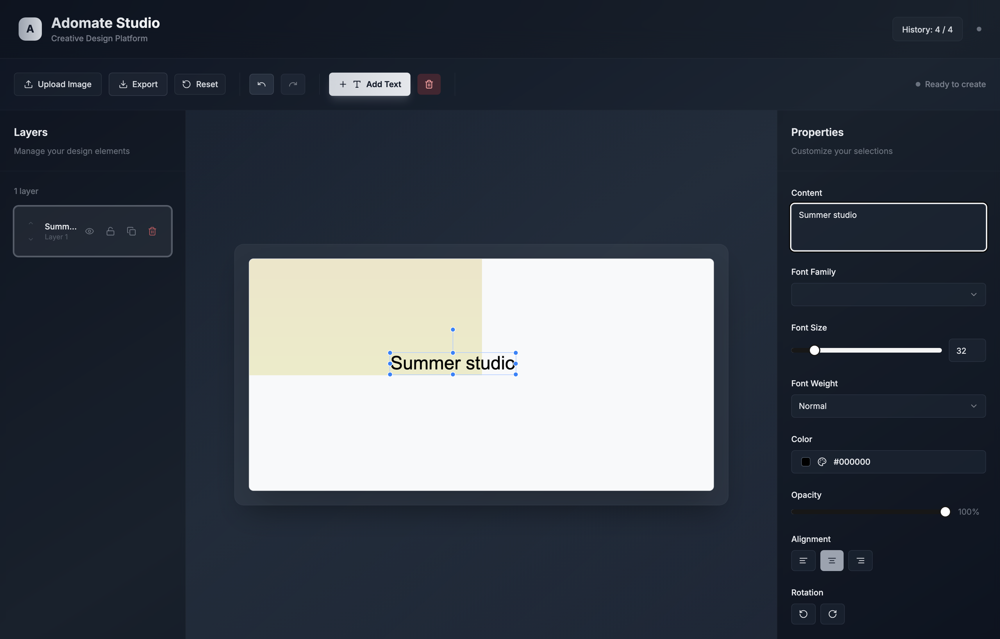
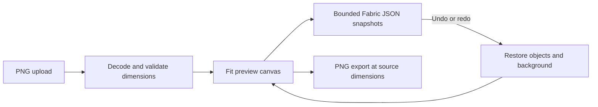

# Image Text Editor

A browser-based editor for putting text on images. Upload a PNG, add text layers on a canvas, style them, and export the result at the original image resolution. Everything runs client-side, there is no backend.



## Features

- PNG upload, with the canvas sized to the image
- Multiple text layers, each with its own font, size, weight, color, opacity and alignment
- Layer panel and properties panel
- Undo and redo
- Export to PNG at the original dimensions
- A curated list of Google Fonts that works without an API key

Built with Next.js 15, React 18, TypeScript, Fabric.js 7, Tailwind CSS and Radix UI components.

## Running it

For development:

```bash
npm ci
npm run dev
```

Then open http://localhost:3000.

Or build and serve the static export with Docker (nginx in the container):

```bash
docker compose up -d --build
```

and open http://localhost:3900.

## Fonts

By default the font picker uses the curated families in `src/lib/curated-fonts.ts`, loaded from the public Google Fonts CSS endpoint. No key is needed for that. If you set `NEXT_PUBLIC_GOOGLE_FONTS_API_KEY`, the app fetches the full Google Fonts catalogue instead.

## Project structure

- `src/app/page.tsx` is the main page
- `src/components/editor/` has the toolbar, canvas, layer panel and properties panel
- `src/hooks/use-editor.ts` holds the editor state and history
- `src/lib/` contains the Fabric helpers and font loading

## Limitations

- Only PNG uploads are accepted.
- Nothing is saved, a page reload clears the design.
- Images are limited to 20 MB and 16 million pixels to bound decoding and history memory.
- History retains the newest 20 canvas snapshots in memory; designs are not persisted on reload.

## Canvas state and export



History stores the serialized canvas and layer metadata together. Undo/redo restore
both, including the background, rather than changing only the sidebar. Reordering
uses Fabric's stacking operation so it does not clear the background. Export uses
the source-to-preview scale and disables retina multiplication; screen pixel density
does not change the dimensions of the downloaded PNG.

To repeat the browser regressions after `npm run build`:

```bash
python3 -m venv .test-venv
.test-venv/bin/pip install playwright==1.56.0
.test-venv/bin/python -m playwright install chromium
.test-venv/bin/python tests/browser_checks.py
```

The checks run a local static server and verify source-resolution export on a retina
viewport, compare exported pixels before/after undo and redo, and ensure a new edit
clears the redo branch. They use a generated geometric PNG fixture, not a paid model
or a remote image. `--capture` refreshes the README screenshot. Framework dependencies
are locked to a patched Next.js 15 maintenance release; container startup remains
unverified on this machine.
